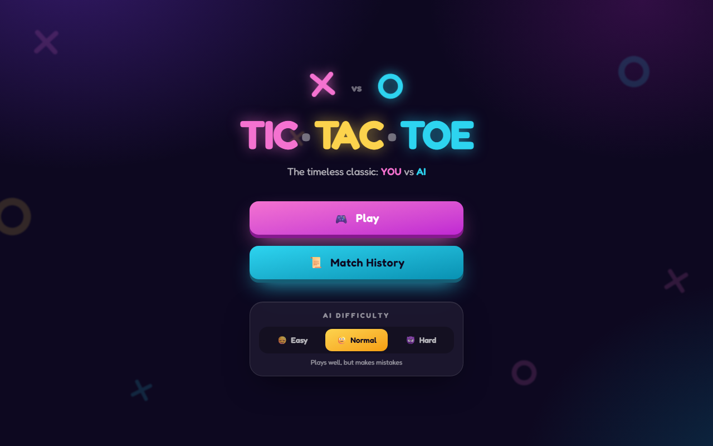
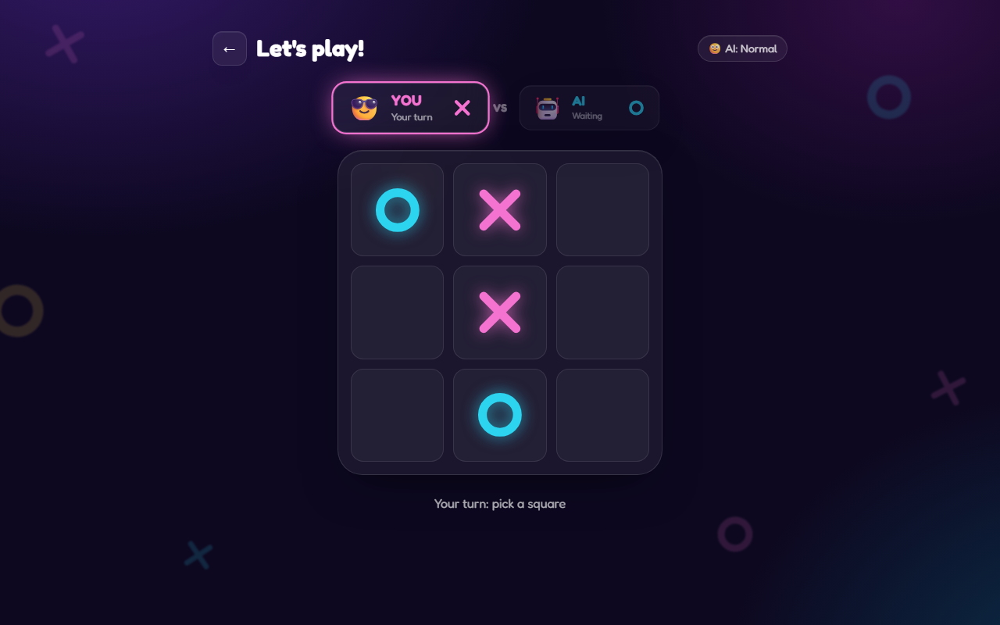

# Tic-Tac-Toe · YOU vs AI

**[▶ Live demo](https://full-stack-tic-tac-toe.vercel.app)**

<p align="center">
  
  
</p>

A full-stack Tic-Tac-Toe game against an AI with three difficulty levels and a persistent match history.
Built with React, Express and PostgreSQL, and deployed on **Vercel** with a **Neon** database.

- **Play** against the AI (Easy, Normal or an unbeatable Hard mode). A coin flip decides who goes first.
- **Match History**: every match is stored, newest first, with stats and a detail view.
- Animated, responsive UI with keyboard and reduced-motion support.
- **Lazy-loaded pages:** each screen is its own chunk, downloaded only when visited (the confetti
  library loads only on a win). If a chunk is missing after a new deployment, the app reloads once
  to pick up the new version.

## Tech stack

| Layer | Technologies |
|---|---|
| Frontend | React 19, Vite 8, TypeScript 7, Zustand 5, Tailwind CSS 4, React Router, Motion |
| Backend | Node.js 24, Express 5, Zod 4, `pg` (node-postgres), Helmet, express-rate-limit |
| Database | PostgreSQL: [Neon](https://neon.tech) in production, [PGlite](https://pglite.dev) locally |
| Tests | Node Test Runner (backend + frontend unit), Playwright (end-to-end) |
| Hosting | Vercel (static frontend on the CDN + the Express API as one Vercel Function) |

## Architecture

```
Production (Vercel)                         Local development
───────────────────                         ─────────────────
Browser                                     Browser
  ├─ /, /play, /history → Vercel CDN          ├─ Vite dev server (localhost:5173)
  │    (frontend/dist + security headers)     └─ Express API (localhost:3000/api)
  └─ /api/* → Vercel Function                        │ pg driver
       (Express app, api/index.js)                   ▼
              │ pg driver                     PGlite: real PostgreSQL running inside
              ▼                               Node, exposed on a local socket
         Neon PostgreSQL                      (no install, no Docker, no account)
```

The backend always talks to PostgreSQL through the same `pg` driver, so local runs and tests
exercise exactly the production code path. Without `DATABASE_URL` it starts an embedded PGlite
database; in production `DATABASE_URL` is required.

## Project structure

```
├─ .github/dependabot.yml    # Weekly dependency updates with a 14-day cooldown
├─ CLAUDE.md                 # Instructions for Claude Code: working agreement, commands, architecture
├─ api/index.js              # Vercel Function entry (re-exports backend/dist/vercel.js)
├─ vercel.json               # Build, rewrites (SPA fallback, never for /assets/), security headers, caching
├─ scripts/check-versions.mjs  # Exact-version / lockfile / .npmrc policy check
├─ backend/                  # MVC Express API
│  ├─ src/
│  │  ├─ index.ts            # Long-running server entry (signals, graceful shutdown)
│  │  ├─ vercel.ts           # Serverless entry (exports the app as a Vercel Function)
│  │  ├─ bootstrap.ts        # Common initialization: database, schema and app
│  │  ├─ server.ts           # HTTP startup (startServer)
│  │  ├─ app.ts              # Express app: middlewares, routes, error handling
│  │  ├─ config.ts           # Environment variables validated with Zod
│  │  ├─ logger.ts           # JSON logger (one line per event)
│  │  ├─ errors.ts           # AppError: status + code + safe message
│  │  ├─ schemas/            # Zod input/output rules (single source of truth) and DTO types
│  │  ├─ controllers/        # Thin async controllers
│  │  ├─ models/             # Data access: the only layer that knows SQL
│  │  ├─ routes/             # Routes → validation middlewares → controllers
│  │  ├─ middlewares/        # Validation, errors, request logs, rate limits
│  │  ├─ db/                 # pg pool, schema, local PGlite
│  │  └─ lib/                # Small helpers (UTC-3 dates)
│  └─ tests/                 # Node Test Runner
└─ frontend/
   ├─ src/                   # React app (lazy-loaded pages, components, game logic, stores)
   └─ tests/                 # unit (Node Test Runner) and e2e (Playwright)
```

## Getting started

Requirements: **Node.js 24** (`.nvmrc` pins 24.21.0, e.g. `fnm use` / `nvm use`) and **npm 11**.

```bash
npm ci        # install the exact versions from package-lock.json
npm run dev   # API on http://localhost:3000/api, app on http://localhost:5173
```

No configuration is needed: matches are stored in a local PGlite database in `backend/data/pglite`
(delete that folder to start fresh). To use a real PostgreSQL instead, copy
`backend/.env.example` to `backend/.env` and set `DATABASE_URL`.

### Environment variables

| Variable | Where | Default | Description |
|---|---|---|---|
| `DATABASE_URL` | backend | — (local PGlite) | PostgreSQL connection string. **Required in production.** Secret. |
| `PGLITE_DIR` | backend | `./data/pglite` | Local database folder when `DATABASE_URL` is empty (`memory://` = ephemeral) |
| `PORT` | backend | `3000` | Local API port |
| `FRONTEND_URL` | backend | `http://localhost:5173` | Origins allowed by CORS in development (comma separated) |
| `RATE_LIMIT_WRITES_PER_MINUTE` | backend | `30` | Match creations/updates allowed per client IP per minute (shared by every instance) |
| `RATE_LIMIT_READS_PER_MINUTE` | backend | `120` | Reads allowed per client IP per minute (per server instance) |
| `VITE_API_URL` | frontend | `http://localhost:3000/api` (dev) · `/api` (build) | API base URL. Public: never put secrets in `VITE_*` |

## Scripts

| Command | Description |
|---|---|
| `npm run dev` | Backend + frontend in watch mode |
| `npm run build` | Type-checks and builds the backend (`backend/dist`) and the frontend (`frontend/dist`) |
| `npm run preview` | Serves the production build like Vercel does (static files + `vercel.json` headers + `/api` proxy) on http://localhost:4173. Run `npm run build` first |
| `npm test` | Script tests, backend tests, frontend unit tests and e2e tests |
| `npm run test:coverage` | Backend tests with coverage thresholds (lines 97%, branches 93%, functions 93%) |
| `npm run check:versions` | Fails if a dependency isn't pinned to an exact version or the lockfile / `.npmrc` policy (including the 14-day release-age window) is missing |
| `npm run audit` | `npm audit` of the production dependencies |
| `npm test -w backend` | Backend tests against real PostgreSQL (PGlite). Test files run one at a time, since each starts its own embedded database |
| `npm run test:unit -w frontend` | Game logic and AI tests |
| `npm run test:e2e -w frontend` | End-to-end tests against the dev servers |
| `npm run test:e2e:prod -w frontend` | End-to-end tests against the production build |
| `npm run test:e2e:remote -w frontend` | Smoke test against a deployment (`E2E_BASE_URL=https://…`) |

Run `npx playwright install chromium` once per machine before the e2e tests. They start their own
servers on dedicated ports with an in-memory database, so they never touch your local data.

## API

Base path: `/api`. Dates are ISO 8601 strings in standard time **UTC-3** (e.g. `2026-10-26T11:30:00.123-03:00`).

```ts
type Match = {
  id: number;
  winner: 'You' | 'AI' | 'Draw' | null; // null = in progress / unfinished
  createdAt: string;
  finishedAt: string | null;
};
```

| Method | Path | Description | Responses |
|---|---|---|---|
| `POST` | `/matches` | Creates a match with `winner: null` | `201` · `429` |
| `GET` | `/matches?limit=&before=` | Matches, most recent first, one page at a time (see below) | `200` · `400` · `429` |
| `GET` | `/matches/stats` | Totals over every match: `{ wins, losses, draws, unfinished, total }` | `200` · `429` |
| `GET` | `/matches/:id` | One match | `200` · `400` invalid id · `404` |
| `PATCH` | `/matches/:id` | Finishes a match. Body: `{ "winner": "You" \| "AI" \| "Draw" }` | `200` · `400` · `404` · `409` already finished · `429` |
| `GET` | `/health` | Health check | `200` |

Every response is JSON, including errors: `{ "error": { "code": "MATCH_NOT_FOUND", "message": "…", "details"?: […] } }`.

| Status | Code | When |
|---|---|---|
| `400` | `VALIDATION_ERROR` · `INVALID_JSON` · `BAD_REQUEST` | Invalid id, body or JSON |
| `404` | `MATCH_NOT_FOUND` · `ROUTE_NOT_FOUND` | Unknown match or route |
| `405` | `METHOD_NOT_ALLOWED` | Unsupported method on a known route (with an `Allow` header) |
| `409` | `MATCH_ALREADY_FINISHED` | The match already has a result |
| `413` | `PAYLOAD_TOO_LARGE` | Body larger than 10 KB |
| `415` | `UNSUPPORTED_MEDIA_TYPE` | Body that isn't JSON, or an unsupported charset / content encoding |
| `429` | `RATE_LIMITED` | Too many reads or writes; see the `RateLimit` / `RateLimit-Policy` headers |
| `500` | `INTERNAL_ERROR` | Unexpected error (details are only logged on the server) |
| `503` | `SERVICE_UNAVAILABLE` | Database unreachable, too slow or out of connections (`Retry-After: 5`) |
| `503` | `SERVER_MISCONFIGURED` | Missing or invalid environment variables on the deployment (`Retry-After: 60`) |

**Pagination:** `GET /matches` returns at most `limit` matches (default 20, max 100) as a plain JSON array.
When there are older matches, the response includes a standard
[`Link`](https://www.rfc-editor.org/rfc/rfc8288) header, e.g. `</api/matches?limit=20&before=42>; rel="next"`.
Request that URL for the next page (keyset pagination on `created_at, id`, so pages stay consistent
while new matches are added).

**Rate limits** (per client IP, per minute): writes (`POST`/`PATCH`) are counted in PostgreSQL, so the limit is
shared by every server instance; reads (`GET`) are counted in memory per instance, so even a flood of reads
never adds load to the database. Database timeouts (5 s to connect, 8 s per query) stay below the 10 s
Vercel Function limit, so a slow database still gets a JSON answer.

Database schema (PostgreSQL naming conventions: snake_case columns, mapped to camelCase in the API):

```sql
CREATE TABLE matches (
  id          INTEGER GENERATED ALWAYS AS IDENTITY PRIMARY KEY,
  winner      TEXT CHECK (winner IN ('You', 'AI', 'Draw')),
  created_at  TIMESTAMPTZ NOT NULL DEFAULT now(),
  finished_at TIMESTAMPTZ,
  CHECK ((winner IS NULL) = (finished_at IS NULL))
);
```

The schema is created automatically (idempotent, protected by an advisory lock) when the server or a
new Vercel Function instance starts.

## Deploying to Vercel + Neon

1. **Create the database** at [neon.tech](https://neon.tech) (free plan). Pick the region closest to
   your Vercel functions (Vercel's default is Washington, D.C. → AWS `us-east-1`). Copy the **pooled**
   connection string (host ends in `-pooler…`, includes `sslmode=require`).
   *Alternative:* add Neon from the Vercel Marketplace (**Storage → Neon**), which creates the database
   and sets `DATABASE_URL` for you.
2. **Import the repository** in Vercel (**Add New → Project**). Keep the repository root as the root
   directory; `vercel.json` already sets the install/build commands, the output directory
   (`frontend/dist`), the API function, rewrites and headers. Node.js 24 is picked from `engines`.
3. **Add the environment variable** `DATABASE_URL` (Production and Preview) and mark it **Sensitive**.
4. **Deploy.** The first request creates the tables.
5. **Verify** the deployment:
   ```bash
   E2E_BASE_URL=https://your-app.vercel.app npm run test:e2e:remote -w frontend
   ```

Every push to `main` deploys to production; other branches get preview deployments.

### Vercel Firewall (recommended)

Vercel mitigates DDoS attacks automatically on every plan. On top of that, add one
[WAF rate limiting rule](https://vercel.com/docs/vercel-firewall/vercel-waf/rate-limiting) (the Hobby plan
includes one) so abusive clients are stopped at the edge, before they reach the function or the database.
Rate limiting rules are configured in the dashboard (not in `vercel.json`):

1. Project → **Firewall** → **Configure** → **+ New Rule**, name it `API rate limit`.
2. **If** `Request Path` **starts with** `/api/`.
3. **Then** **Rate Limit**: Fixed Window, **60 s** window, **100** requests, key **IP**, action **Default (429)**.
4. **Save Rule** → **Review Changes** → **Publish** (applies immediately, no redeploy needed).

Tip: create it first with the **Log** action, watch the traffic for a while, then switch to **429**.
The app's own limits stay in place as a second layer.

## Security

- **Secrets:** the only secret is `DATABASE_URL`. Locally it lives in `backend/.env` (git-ignored);
  on Vercel it's a Sensitive environment variable. It's never exposed to the browser.
- **Input validation:** params and bodies are validated with Zod; SQL queries are parameterized.
- **Rate limiting:** two layers. At the edge, an optional Vercel Firewall rule (see above). In the app,
  writes are limited per client IP with counters in PostgreSQL (shared by every function instance) and
  reads with in-memory counters (no database cost). Only a SHA-256 hash of the IP is ever stored.
- **Bounded responses:** the match list is paginated (max 100 per request), so responses stay small
  no matter how large the history grows.
- **HTTP headers:** strict Content-Security-Policy, HSTS, `X-Frame-Options: DENY`, `nosniff`,
  `Referrer-Policy` and `Permissions-Policy` (Helmet for the API, `vercel.json` for static files).
- **Errors:** every API response is JSON and never includes stack traces or SQL details. Database
  outages and a misconfigured deployment return a JSON 503 instead of crashing. In the UI, an error
  boundary replaces any unexpected rendering error with a recovery screen instead of a blank page.
- **Logs:** one JSON line per request (method, path without query string, status, duration); never
  IPs, bodies or headers. 5xx errors are logged with their stack trace, which never reaches the client.
- **Dependencies:** exact versions enforced by `npm run check:versions`, committed lockfile and
  `npm audit` with 0 known vulnerabilities.
- **Supply chain:** npm only installs versions published at least 14 days ago (`min-release-age` in
  `.npmrc`), and Dependabot version updates use the same 14-day cooldown. Malicious or broken releases
  are usually caught and pulled within days. A security fix newer than the window is installed as a
  one-off exception, e.g. `npm audit fix --min-release-age-exclude=<package>` (this is how
  `body-parser` 2.4.0 got in: it fixes a high-severity DoS advisory).
- Recommended GitHub settings: enable **Secret scanning**, **Push protection** and **Dependabot alerts**
  (security alerts are not delayed by the cooldown).

## Operation

- **Graceful shutdown** of the long-running server on `SIGTERM`/`SIGINT`: it stops accepting
  connections, finishes the active ones and closes the database (forced exit after 10 s).
- **Startup failures** (invalid configuration, port in use, database unreachable) exit with code 1 and
  a clear JSON log line.
- **Health check:** `GET /api/health` is a liveness probe that doesn't touch the database (on Neon's free
  plan, polling the database would keep it awake and consume compute hours).

## Reproducible installs

- Every dependency is pinned to an exact version and `package-lock.json` locks the full tree with integrity hashes.
- `.npmrc` enforces `save-exact`, `engine-strict` (Node 24.x, npm 11.x) and `min-release-age=14`.
  Use `npm ci` to install: it installs the lockfile exactly as committed.
- `.nvmrc` pins Node 24.21.0 for local development; hosting platforms may apply newer 24.x patch releases.

## How this was built

This project was built with an AI coding agent, [Claude Code](https://claude.com/claude-code), working
under my direction. Commits written with the agent carry a `Co-Authored-By: Claude` trailer, which is
why it appears among the contributors.

**My role: product, architecture decisions and review**

- Wrote the original specification: the game, the match history, the REST API and the data model.
- Made the key decisions:
  - the stack;
  - PostgreSQL on Neon instead of SQLite, so data persists on serverless hosting;
  - a Vercel-only deployment;
  - the MVC (Model-View-Controller) architectural pattern for the backend;
  - Node Test Runner and Playwright for testing;
  - English for the whole codebase.
- Set the quality and security bar:
  - strict handling of secrets and environment variables;
  - exact dependency versions with a 14-day minimum release age;
  - rate limiting and JSON errors everywhere;
  - pagination;
  - route-level lazy loading;
  - a single clean initial commit.
- Required a written plan before any code change, reviewed it, and asked for the reasoning behind
  each decision (for example, how parameterized queries prevent SQL injection).
- Did the deployment myself: the Neon database, the Vercel project and its environment variables,
  the Vercel Firewall rule, and the GitHub security settings (secret scanning, push protection,
  Dependabot).

**The agent's role: implementation and verification**

- Researched current library versions and platform documentation before using them.
- Implemented the frontend, the backend, the tests and the documentation according to the approved plans.
- Ran the full verification before every commit: type checks, the build, the unit, integration and
  end-to-end suites (development and production builds), coverage thresholds, `npm audit`, the
  version policy and a secret scan of the staged files.
- Investigated intermittent test failures down to their root cause instead of retrying them.

**The workflow**

1. I describe the feature or change.
2. The agent proposes a plan; nothing is coded until I approve it.
3. The agent implements and verifies; I review the result and ask questions.
4. The agent prepares the commit; I push it myself, and Vercel deploys from GitHub.

The working agreement, commands and architecture notes live in [`CLAUDE.md`](CLAUDE.md), which the
agent loads at the start of every session, so the rules don't depend on the conversation's memory.

## License

[MIT](LICENSE)
